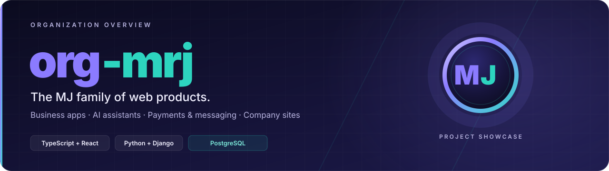

# org-mrj

**The MJ family of web products, built and run as one portfolio.**

Business apps · AI assistants · Payments & messaging · Company sites

<kbd>TypeScript</kbd> <kbd>React</kbd> <kbd>Python / Django</kbd> <kbd>PHP</kbd> <kbd>PostgreSQL</kbd>

[What we build](#what-we-build) &nbsp; / &nbsp;
[How we work](#how-we-work) &nbsp; / &nbsp;
[Live demos](#live-demos) &nbsp; / &nbsp;
[About this repository](#about-this-repository)

---

> [!NOTE]
> Most project repositories in this organization are **private**. This page is a
> public, high-level overview only: it describes categories of work, not
> individual codebases, hosts or customers.

## What we build

| Category | What it covers |
| :--- | :--- |
| **Business web apps** | Point of sale, ISP billing, hospital management, e-commerce, school management and learning platforms |
| **Customer engagement** | Live chat with AI-assisted support, help-centre content and website widgets |
| **AI assistants & automation** | Conversational assistants, content and video automation pipelines, workflow automation |
| **Payment & SMS infrastructure** | Payment gateway services, merchant tooling and SMS gateway integrations |
| **Finance & data tools** | Market and portfolio tracking dashboards |
| **Marketing & workforce tools** | Campaign attribution, analytics and team task platforms |
| **Developer tools** | Command-line tools, GitHub CLI extensions and edge/serverless workers |
| **Company & portfolio sites** | Company websites, portfolio pages and organisation sites |

## How we work

- **Source first.** Projects keep their README and developer guides next to
  the code, so documentation can be reviewed alongside the change.
- **Reviewed changes.** Work is proposed on branches and pull requests, with
  automated checks where a project has them.
- **Secrets stay out of repositories.** Configuration is supplied per
  environment, and server-side checks decide what a user may do.
- **Demo data stays demo data.** Presentation builds use synthetic data and
  read-only viewer accounts.

## Live demos

Selected projects have public, presentation-only demos linked from the
solutions page at **[mjony3.com/solutions](https://mjony3.com/solutions/)**.
The main portfolio is at **[mjony3.com](https://mjony3.com)**.

## About this repository

| File | Purpose |
| :--- | :--- |
| `README.md` | This overview |
| `docs/assets/readme-banner.svg` | Header artwork for this page |
| `.github/ISSUE_TEMPLATE/` | Issue templates for bug reports and feature requests |
| `.github/workflows/static.yml` | GitHub Pages publishing |
| `LICENSE` | Repository license |

The [Pages workflow](.github/workflows/static.yml) runs on every push to `main`
(or by manual dispatch) and uploads the **entire repository** as the Pages
site, without a build step. Anything committed here is therefore public twice:
in the repository and on the Pages site.

---

**Build deliberately. Verify the boundary. Keep the evidence.**

[mjony3.com](https://mjony3.com) &nbsp; / &nbsp; [License](LICENSE)

